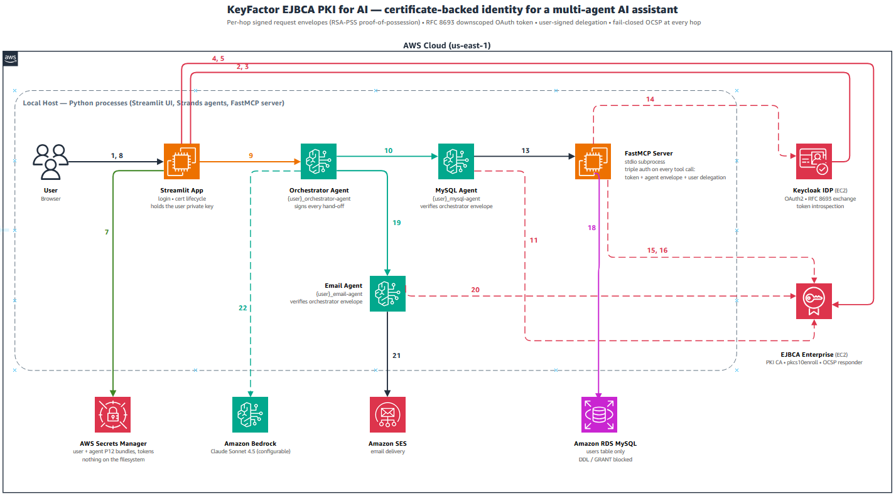

# KeyFactor EJBCA PKI for AI

AI Database Assistant demo with triple certificate-based authentication using KeyFactor EJBCA PKI, Keycloak IDP, and AWS Bedrock.

> **Note:** This is a demonstration project intended for learning and development purposes. It is not intended for production use without additional security hardening and review.



## Overview

This project demonstrates how to secure AI agent communications using X.509 certificates issued by [KeyFactor EJBCA](https://www.keyfactor.com/products/ejbca-enterprise/) PKI. It implements three layers of authentication:

1. **User Authentication** — OAuth token (Keycloak) + X.509 certificate (EJBCA)
2. **Agent-to-Agent Authentication** — Per-user agent certificates validated via OCSP
3. **MCP Server Triple Authentication** — User token + user cert + agent cert validated on every database operation

## Features

- **Triple MCP Authentication** — Three credentials validated on every tool call
- **Per-User Agent Certificates** — Each user gets isolated agent certs (`{user}_orchestrator-agent`, `{user}_mysql-agent`)
- **EJBCA PKI Integration** — Short-lived certificates (7-day validity) for users and agents
- **OCSP Real-Time Validation** — Certificate revocation checked against EJBCA on every request
- **Certificate Auto-Login** — Gmail-style account selection, no password on subsequent logins
- **AWS Secrets Manager** — All certificates and tokens stored securely (not on filesystem)
- **Strands Multi-Agent Architecture** — Orchestrator routes to MySQL and Email sub-agents
- **MCP Protocol** — MySQL Agent connects to FastMCP Server via stdio transport
- **Natural Language SQL** — Ask questions in plain English, agent converts to SQL
- **Auto Token Refresh** — Expired tokens refreshed automatically before queries
- **Secure Logout** — Revokes user cert + all agent certs in EJBCA + deletes from Secrets Manager

## Architecture

```
User (Browser)
  |
  | 1. Login (username + password)
  v
Streamlit App --2. Password Grant--> Keycloak IDP
  |                                     ^
  | 3. Issue user + agent certs         |
  v                                     |
EJBCA Enterprise (PKI CA)               |
  |                                     |
  | 4. Store in Secrets Manager         |
  v                                     |
AWS Secrets Manager                     |
  |                                     |
  | 5. User query                       |
  v                                     |
Orchestrator Agent [{user}_orchestrator-agent]
  |           |
  | 6-7       | 14-15
  v           v
MySQL Agent   Email Agent
[validates    [validates
 orch cert]    orch cert]
  |
  | 8. MCP + user token + user cert + mysql-agent cert
  v
FastMCP Server (Triple Auth)
  | 9.  Validate token ---------> Keycloak /introspect
  | 10. Validate user cert -----> EJBCA OCSP
  | 11. Validate agent cert ----> EJBCA OCSP
  | 12. Cross-check identities
  | 13. Execute SQL
  v
Amazon RDS MySQL
```

## Prerequisites

- **Python 3.9+**
- **AWS Account** with access to:
  - Amazon Bedrock (Claude Sonnet 4.5 or compatible model)
  - Amazon RDS MySQL
  - Amazon SES (with verified sender email)
  - AWS Secrets Manager
- **Keycloak Server** — OAuth2 IDP with realm and client configured
- **EJBCA Enterprise Server** — PKI CA with REST API V1 enabled
- **EJBCA API Admin Certificate** — P12 file for REST API authentication

There are two ways to set up this infrastructure: the Long Setup or the Scripted Setup. The scripted setup deploys EJBCA and Keycloak locally on Docker. If you are using deployments of EJBCA and Keycloak elsewhere, use the Long Setup.

## Scripted Setup

### 1. Clone and Install

```bash
git clone https://github.com/your-username/keyfactor-ejbca-pki-for-ai.git
cd keyfactor-ejbca-pki-for-ai

python -m venv .venv

# Windows
.venv\Scripts\activate

# macOS / Linux
source .venv/bin/activate

pip install -r requirements.txt
```

### 2. Configure Setup Script

If you are on Windows, you will be using `scripts/setup.bat`. If you are on Mac or Linux, you will be using `scripts/setup.sh`.

Go into your preferred script, and starting around line 20 on both, you will see a configuration section. Most of the settings can stay as they are (however, you should look through all of them). The main four you may want to configure are:

- `PROJECT_TAG` — Descriptive tag for tracking created AWS resources
- `AWS_REGION` — Your preferred AWS region
- `BEDROCK_MODEL_ID` — ID of the Bedrock model you would like the agent to use
- `SES_SENDER_EMAIL` — The email address that emails from the Email Agent will come from (must be an email you own)

See the [Configuration](#configuration) section for an explanation of all variables.

### 3. Run Setup Scripts

```bash
# Windows
scripts\setup.bat

# macOS / Linux
./scripts/setup.sh
```

The setup script will:
1. Create the `.venv` folder and install dependencies
2. Generate a `.env` file with the necessary values and secrets
3. Deploy Keycloak and EJBCA locally in Docker
4. Provision an AWS RDS MySQL Database, SES Sender, and check Bedrock Model Access

### 4. Launch the Streamlit App

```bash
# Windows
scripts\run.bat

# macOS / Linux
./scripts/run.sh
```

Access the app at **http://localhost:8501**

### 5. Cleanup Resources

When you are done using the streamlit app and wish to cleanup the resources on AWS:

```bash
# Windows
scripts\cleanup.bat

# macOS / Linux
./scripts/cleanup.sh
```

This will remove the RDS MySQL database, delete any remaining secrets, and remove the sender email from AWS.

---

## Long Setup

### 1. Clone and Install

```bash
git clone https://github.com/your-username/keyfactor-ejbca-pki-for-ai.git
cd keyfactor-ejbca-pki-for-ai

python -m venv .venv

# Windows
.venv\Scripts\activate

# macOS / Linux
source .venv/bin/activate

pip install -r requirements.txt
```

### 2. Configure Environment

```bash
cp .env.example .env
```

Edit `.env` with your actual values. See [Configuration](#configuration) below.

### 3. Place EJBCA Certificates

Place your EJBCA certificates in the `certs/` directory:

```bash
cp /path/to/your/api-admin.p12 ./certs/api-admin.p12
cp /path/to/your/UserCA.pem ./certs/UserCA.pem
```

See [`certs/README.md`](certs/README.md) for detailed instructions on generating these from your EJBCA server.

| File | Purpose |
|------|---------|
| `certs/api-admin.p12` | Authenticates REST API calls to EJBCA |
| `certs/UserCA.pem` | CA trust anchor for OCSP validation |

These files are **gitignored** and must be generated from your own EJBCA instance.

### 4. Configure Keycloak

**Keycloak 26.2 or newer is required** — the app downscopes the login token with RFC 8693 *standard* token exchange, which older versions do not implement.

1. Create realm: `mcp-realm`
2. Create client: `mcp-app-client` (confidential, with client secret)
3. Enable Direct Grant (Resource Owner Password Credentials)
4. Configure X.509 Direct Grant flow (optional, for mTLS auto-login)
5. Import EJBCA CA certificate into Keycloak's Java truststore
6. Enable mTLS: `--https-client-auth=request`

### 5. Configure Keycloak Token Exchange (RFC 8693)

> At login the full-session token is exchanged for a token whose audience is restricted to the MCP server; only that downscoped token is handed to the agents. The MCP server rejects any token whose `aud` does not contain `KEYCLOAK_TOKEN_AUDIENCE`.

In the Keycloak admin console (realm `mcp-realm`):

1. On client `mcp-app-client`, enable **Standard Token Exchange** (client attribute `standard.token.exchange.enabled=true`)
2. Create a client named `mcp-server` — it exists only to be a valid `aud` value, so leave all flows disabled
3. Create a client scope named `mcp-audience` (protocol `openid-connect`, *Include in token scope* on) containing an **Audience** mapper with *Included Client Audience* = `mcp-server` and *Add to access token* on
4. Attach `mcp-audience` to `mcp-app-client` as an **Optional** client scope

Alternatively, use the provisioning helper script:

```bash
KC_HOST=https://your-keycloak-server:8443 \
KC_REALM=mcp-realm \
KC_CLIENT_ID=mcp-app-client \
KC_ADMIN_USER=admin \
KC_ADMIN_PASSWORD=your-admin-password \
KC_AUDIENCE=mcp-server \
KC_EXCHANGE_SCOPE=mcp-audience \
python scripts/kc_token_exchange.py
```

### 6. Configure EJBCA

1. Create CA: `UserCA` (RSA 2048+, `EJBCA_CA_NAME`)
2. Enable the **REST Certificate Management** protocol (System Configuration > Protocol Configuration)
3. Choose a Certificate Profile and End Entity Profile that allow the app's CSRs
4. Create the API admin certificate (`certs/api-admin.p12`) and grant it the **Super Administrator** role
5. Enable the OCSP responder for the issuing CA

Certificates are generated with client-side keypairs: the private key is created in the app, only a CSR goes to EJBCA, and the resulting cert + key are stored in AWS Secrets Manager.

### 7. Configure AWS

1. **RDS MySQL**: Create database `mysqldb` with a `users` table
2. **SES**: Verify sender email address (sandbox mode only sends to verified recipients)
3. **Secrets Manager**: No manual setup needed — the app creates secrets automatically
4. **Bedrock**: Enable access to Claude Sonnet 4.5 (or your chosen model)
5. **IAM**: Ensure your AWS credentials have access to Bedrock, SES, Secrets Manager, and RDS

### 8. Run

```bash
# Windows
scripts\run.bat

# macOS / Linux
./scripts/run.sh
```

Access the app at **http://localhost:8501**

---

## Configuration

| Variable | Description | Example |
|----------|-------------|---------|
| `AWS_REGION` | AWS region | `us-east-1` |
| `BEDROCK_MODEL_ID` | Bedrock model inference profile | `us.anthropic.claude-sonnet-4-5-20250929-v1:0` |
| `BEDROCK_STREAMING` | Use the streaming Bedrock API | `false` |
| `SES_SENDER_EMAIL` | Verified SES sender email | `your-email@gmail.com` |
| `KEYCLOAK_URL` | Keycloak server URL | `https://your-server:8443` |
| `KEYCLOAK_REALM` | Keycloak realm name | `mcp-realm` |
| `KEYCLOAK_CLIENT_ID` | OAuth client ID | `mcp-app-client` |
| `KEYCLOAK_CLIENT_SECRET` | OAuth client secret | (from Keycloak) |
| `KEYCLOAK_ADMIN_USER` | Keycloak admin username | `admin` |
| `KEYCLOAK_ADMIN_PASSWORD` | Keycloak admin password | (your password) |
| `KEYCLOAK_TOKEN_AUDIENCE` | Audience for downscoped token | `mcp-server` |
| `KEYCLOAK_TOKEN_EXCHANGE_SCOPE` | Client scope for audience mapping | `mcp-audience` |
| `EJBCA_URL` | EJBCA server URL | `https://your-ejbca-server` |
| `EJBCA_CA_NAME` | Certificate Authority name | `UserCA` |
| `EJBCA_CERT_PROFILE` | Certificate profile | `ENDUSER` |
| `EJBCA_END_ENTITY_PROFILE` | End entity profile | `EMPTY` |
| `EJBCA_API_ADMIN_CERT_PATH` | Path to admin P12 cert | `./certs/api-admin.p12` |
| `EJBCA_API_ADMIN_CERT_PASSWORD` | Admin cert password | (your password) |
| `EJBCA_ISSUING_CA_CERT` | Issuing-CA PEM file | `./certs/UserCA.pem` |
| `CERT_VALIDITY_DAYS` | Certificate lifetime | `7` |
| `ENVELOPE_MAX_AGE_SECONDS` | Max age of signed envelope | `60` |
| `DELEGATION_MAX_AGE_HOURS` | Delegation assertion lifetime | `12` |
| `RDS_HOST` | MySQL RDS endpoint | `your-db.rds.amazonaws.com` |
| `RDS_USER` | Database username | `admin` |
| `RDS_PASS` | Database password | (your password) |
| `RDS_DB` | Database name | `mysqldb` |

---

## Project Structure

```
.
├── .env.example              # Environment template (copy to .env)
├── .gitignore                # Git exclusions
├── requirements.txt          # Python dependencies
├── streamlit_app.py          # Web UI, user auth, chat interface
├── fastmcp_server.py         # MCP Server (triple auth + SQL execution)
├── ARCHITECTURE.md           # Detailed architecture documentation
├── README.md                 # This file
│
├── scripts/
│   ├── setup.sh              # macOS/Linux setup script
│   ├── setup.bat             # Windows setup script
│   ├── run.sh                # macOS/Linux run script
│   ├── run.bat               # Windows run script
│   ├── cleanup.sh            # macOS/Linux cleanup script
│   ├── cleanup.bat           # Windows cleanup script
│   └── kc_token_exchange.py  # Keycloak token exchange provisioning
│
├── config/
│   ├── __init__.py
│   └── settings.py           # Central configuration (loads .env)
│
├── auth/
│   ├── __init__.py
│   ├── keycloak_auth.py      # Keycloak OAuth + user cert issuance
│   ├── certificate_manager.py # User cert CRUD (AWS Secrets Manager)
│   ├── agent_cert_manager.py # Per-user agent cert issuance
│   └── session.py            # Agent session bootstrap + token exchange
│
├── agents/
│   ├── __init__.py
│   ├── orchestrator_agent.py # Routes queries to sub-agents
│   ├── mysql_agent.py        # Validates orchestrator, calls MCP server
│   └── email_agent.py        # Validates orchestrator, sends via SES
│
├── pki/
│   ├── __init__.py
│   ├── envelope.py           # Signed envelope creation/verification
│   ├── delegation.py         # User delegation assertions
│   ├── ocsp.py               # OCSP revocation checking (fail-closed)
│   └── keys.py               # P12 key extraction utilities
│
├── certs/
│   └── README.md             # Instructions for EJBCA certs
│   # api-admin.p12           # (gitignored) EJBCA API admin cert
│   # UserCA.pem              # (gitignored) CA trust anchor
│
└── generated-diagrams/       # Architecture diagrams
    ├── diagram.png
    ├── Traffic flow.png
    └── pki-for-ai-architecture-flow.drawio
```

---

## Security Model

### Authentication Chain

```
User cert + OAuth token
       |
       v
Orchestrator Agent [cert: {user}_orchestrator-agent]
       |
       | passes orchestrator cert
       v
MySQL Agent [validates: CN ends with _orchestrator-agent]
       |
       | passes: user token + user cert + {user}_mysql-agent cert
       v
MCP Server [validates ALL THREE]:
  ✓ User token (Keycloak introspect, active=true)
  ✓ User cert (expiry + OCSP against EJBCA)
  ✓ Agent cert (CN={user}_mysql-agent, expiry + OCSP)
  ✓ Cross-check: token username == user cert CN
       |
       v
  Execute SQL
```

### Certificate Lifecycle

| Event | Action |
|-------|--------|
| User login | Issue user cert + 3 agent certs from EJBCA, store in Secrets Manager |
| Query | Validate all certs via OCSP, refresh token if expired |
| Logout | Revoke user cert + all agent certs in EJBCA, delete from Secrets Manager |
| Cert expired | Auto-detected, user must re-login with password |
| Cert revoked externally | Detected via OCSP, deleted from Secrets Manager, re-issued on next login |

### Secrets Manager Storage

| Path | Content |
|------|---------|
| `mcp/certs/{user}/certificate` | User P12 + metadata |
| `mcp/certs/{user}/token` | OAuth tokens |
| `mcp/certs/users` | List of users with certs |
| `mcp/agents/{user}/orchestrator-agent/certificate` | Orchestrator agent P12 |
| `mcp/agents/{user}/mysql-agent/certificate` | MySQL agent P12 |
| `mcp/agents/{user}/email-agent/certificate` | Email agent P12 |

---

## Usage Examples

```
"Show me all users in the database"
"How many users are there?"
"List usernames and emails from the users table"
"Send the user list to user@example.com"
```

---

## Troubleshooting

| Issue | Solution |
|-------|----------|
| Token expired | Re-login with password (auto-refresh handles most cases) |
| Agent cert not found | Auto-issued on login; check EJBCA connectivity |
| SES emails not arriving | Sandbox mode — only verified recipients receive email |
| RDS timeout | Check IP in RDS security group |
| Keycloak unreachable | `sudo docker start keycloak-prod` on EC2 |
| Token exchange fails at login | Keycloak must be 26.2+ with Standard Token Exchange enabled |
| MCP call rejected: missing audience | Check `KEYCLOAK_TOKEN_AUDIENCE` matches the audience client |
| OCSP denies every request | Enable OCSP responder for the issuing CA in EJBCA |
| EJBCA cert issuance fails | Enable REST Certificate Management protocol |
| `.venv` not found (macOS) | Run `python3 -m venv .venv && source .venv/bin/activate` |
| `.venv` not found (Windows) | Run `python -m venv .venv && .venv\Scripts\activate` |
| Permission denied on run.sh | Run `chmod +x scripts/run.sh` |

---

## License

MIT

## Acknowledgments

- [KeyFactor EJBCA](https://www.keyfactor.com/products/ejbca-enterprise/) — Enterprise PKI
- [Keycloak](https://www.keycloak.org/) — Identity and Access Management
- [AWS Bedrock](https://aws.amazon.com/bedrock/) — Foundation Models
- [Strands Agents SDK](https://github.com/strands-agents/sdk-python) — AI Agent Framework
- [FastMCP](https://github.com/jlowin/fastmcp) — Model Context Protocol Server
